<!-- SPDX-License-Identifier: GPL-2.0-only -->
# NT 5.1 Embedded with XFCE

An experimental Windows XP SP1 x86 kernel system with a native init process, an NT-to-Linux syscall translation layer, musl 1.2.5 and BusyBox 1.36.1. The larger image runs Alpine's XFCE 4.18 applications and Xvfb through the translation layer and a QEMU framebuffer bridge.

This repository contains build definitions, patches and the embedded port. NT source is a pinned external Bazel dependency fetched from [vipinkiruba/kernel-NT5.1](https://github.com/vipinkiruba/kernel-NT5.1/tree/1b390dddff9fe017e9c11a7845c67a887c3483dc), patched during repository initialization. Kernel source and generated binaries are excluded from Git.

## Build on Windows

Install Git with [Git LFS](https://git-lfs.com), Bazel 9.2.0, Python 3.13 or newer, and LLVM with clang, ld.lld, llvm-ar and llvm-strip. Put their executables on PATH. The NT dependency supplies its historical x86 compiler and assembler. Use a short directory path without spaces for the legacy tools.

```powershell
cd nt51_xfce4_embedded
$buildCache = Join-Path $env:SystemDrive 'nt51-bazel'
bazel --output_user_root="$buildCache" build //:kernel_bundle
bazel --output_user_root="$buildCache" build //:minimal_image
bazel --output_user_root="$buildCache" build //:xfce_image
bazel --output_user_root="$buildCache" build //chromium_rootfs:usb_image
```

The XFCE target depends on the minimal image, so its graph builds the kernel and boot support, native runtime, minimal system/image, and then the XFCE system/image. musl and BusyBox release archives and every Alpine package are checked against pinned SHA-256 hashes.

Optionally pass `--repo_env=NT51_GIT_CACHE=<existing-clone>` to use an existing Git object cache. It contributes committed objects at the pinned revision; modified working files and prior build artifacts are never copied. Without the option, the dependency is fetched from GitHub.

The native Bazel kernel rules compile available C and assembly sources into individual declared objects and libraries. Boot support uses the original build.exe/nmake toolchain inside a writable copy of the external dependency. Failures and missing outputs stop the build. Its outputs include the freshly built NT loader, detector, storage/filesystem/bus drivers and NLS data. All three rootfs actions compile their own libc, shim, BusyBox, drivers, init and NT test suite.

Host Python and LLVM are selected from PATH. The build uses local host tools and is not hermetic. Clean the Bazel outputs when changing host tool versions.

## Linux build status

Linux builds require Bazel, Python, LLVM, Wine and `wibo` on PATH. The prebuilt `chrome` and `headless_shell` executables are stored with Git LFS; run `git lfs install` before cloning, or `git lfs pull` in an existing clone. C/assembly and resource compiler actions use `wibo`; the linker, message compiler and boot-support build use Wine. Separate Wine prefixes isolate concurrent build actions. Boot support rebuilds the message compiler with corrected buffer handling and inspects the generated drivers. The guest executes native NT code and Linux ELF binaries through its syscall shim.

The Bazel build has no Chromium compilation action. It packages the binaries in `chromium_rootfs/pkg/opt/chromium/`. These are built from Chromium revision `7cc9d0d833549df75d31f9049130b05e3d1c9f84` with the NT compatibility patch. The [build provenance](chromium_rootfs/pkg/opt/chromium-build.json) records source/dependency revisions, GN arguments, artifact hashes and privacy scan results; see the [rebuild guide](chromium_rootfs/patches/README.md). Current results and limitations are recorded in [docs/verification.json](docs/verification.json); historical Windows results do not establish Linux build or runtime success.

The verification records cover all three images and these runs. Each completed boot passed 54/54 NT test cases and `ps aux`. The table reflects the 2026-10-18 review (`current_review` in [docs/verification.json](docs/verification.json)), run on Linux with freshly built images and the supplied prebuilt Chromium; Chromium was not rebuilt.

| Image | IDE verification | UHCI USB verification |
| --- | --- | --- |
| Minimal | Passed | Passed |
| XFCE | Passed, including visible desktop windows | Passed, including visible desktop windows |
| Chromium | Passed: SwiftShader probe, computed headless DOM, natural exit without timeout, visible Yahoo GUI and received NIC data | Browser assets unavailable through the IDE-only transport; browser verification fails |

Current captures: [minimal](docs/screenshots/verified-minimal.png), [XFCE](docs/screenshots/verified-xfce.png), [Chromium](docs/screenshots/verified-chromium.png).

### Keyboard and mouse input

QEMU's emulated PS/2 keyboard and mouse drive all three images. The 2026-10-18 review injected input through QMP (`send-key` and `input-send-event`), which uses the same QEMU input path as the SDL window:

* Minimal: typed commands ran in the BusyBox shell, including pipelines ([capture](docs/screenshots/minimal-shell.png)).
* XFCE: mouse motion and a left click focused the terminal; the typed commands below ran in it.
* Chromium: the mouse wheel scrolled yahoo.com down and back up, a click opened Yahoo's search field and typed text appeared in it, and a click on the taskbar raised the terminal.

The raw input driver enables the PS/2 IntelliMouse wheel and reports its delta with each packet. The X11 bridge turns it into XTEST button 4 (up) and 5 (down) clicks. Click inside the QEMU window to grab the mouse; Ctrl+Alt+G releases it.

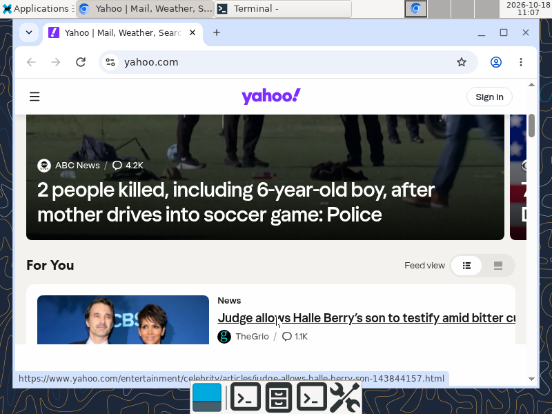

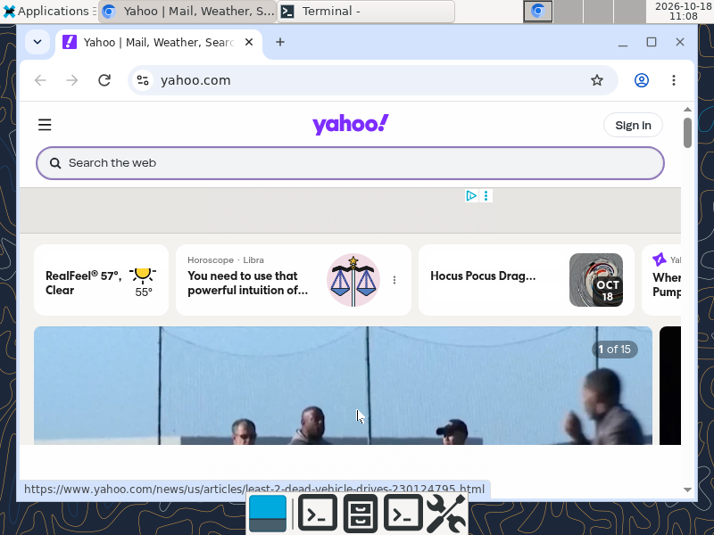

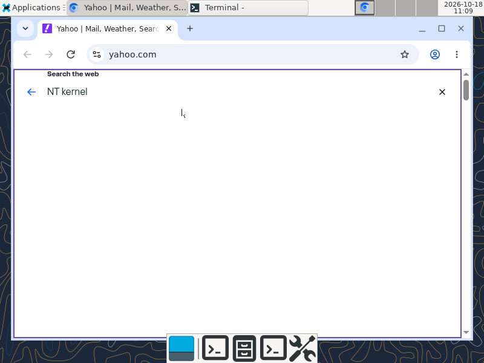

### 2026-10-18 fixes

* The Chromium RAM disk is 192 MiB. At 128 MiB the GUI profile could not create its ProcessSingleton socket directory, and Chromium aborted after the headless check.
* BusyBox applets run in-process after an emulated vfork. Each exited child is now recorded for `wait4`; pipelines previously reused one PID and reported status 255. An applet starts with clean stdio state and a zeroed `bb_common_bufsiz1`, as after a real exec. `grep` previously reused stale patterns, and `head` saw an EOF left by an earlier child.
* The minimal shim gives each vfork child its own descriptor and pipe-end references, and pipe buffers are refcounted. Every pipeline previously failed with `can't duplicate file descriptor` or a broken pipe.
* `isatty()` is false for pipes, sockets, `/dev/null` and files, including redirected standard descriptors. `ls` no longer writes terminal columns and colors into pipes.

The Chromium cleanup fixes preserve musl’s allocation ownership when updating thread stack attributes, atomically claim thread slots, and defer stack reuse until NT reports thread termination. The headless verifier requires valid computed DOM, actual exit status zero, and an explicit zero timeout flag.

The earlier Chromium rebuild also passed IDE verification with the replacement binaries: 54/54 NT tests, SwiftShader rendering, computed headless DOM with natural exit and no timeout, and a visible Yahoo page with received network data. See the `chromium_rebuild` record in [verification results](docs/verification.json) and the [new capture](docs/screenshots/chromium-rebuild.png). The table above preserves the earlier all-variant review.

## Images and QEMU

Outputs:

* `bazel-bin/minimal_rootfs/usb_image.files/minimal_usb.img`
* `bazel-bin/rootfs/usb_image.files/xfce_usb.img`
* `bazel-bin/chromium_rootfs/usb_image.files/chromium_usb.img`

Each raw disk contains an MBR, FAT16 boot partition, NTLDR, NTDETECT and a FAT16 RAM disk. The image action also writes a rootfs manifest with file hashes. The minimal disk is 192 MiB; the XFCE disk is 384 MiB; the Chromium disk is 896 MiB.

Install QEMU with SDL support, then put qemu-system-i386 on PATH or set `QEMU_BINARY` to its executable. The launcher opens a window on the interactive Windows desktop and uses snapshot mode.

```powershell
python tools/qemu.py minimal --verify
python tools/qemu.py xfce --verify
python tools/qemu.py chromium --verify --timeout 1800
```

Boot init runs `nttest.elf all`. Verification requires nine completed suites, nonzero individual tests, zero failures and exit status zero. Serial logs, screenshots, image hashes and verification JSON are saved under `runtime/<variant>` (including `runtime/chromium`). A timeout or absent summary fails verification.

All three images also run `ps aux` at startup and require exit status zero. XFCE verification additionally queries the actual X11 window tree and requires viewable windows for the top panel, bottom dock, terminal and desktop. Starting Xvfb or obtaining XTEST support alone does not pass this check.

To exercise USB storage boot instead of the default IDE attachment:

```powershell
python tools/qemu.py minimal --usb --verify --timeout 360
python tools/qemu.py xfce --usb --verify --timeout 360
```

The launcher uses QEMU's UHCI USB controller and USB mass storage device. These runs save evidence in `runtime/minimal-usb` and `runtime/xfce-usb`. Snapshot mode preserves the built disk. The launcher keeps a runtime reference to it (a hard link on Linux, a copy on Windows), so the Bazel output remains rebuildable while QEMU is running.

Chromium browser assets currently require the IDE disk transport. The Chromium image can boot NT and XFCE from USB, but its raw-sector browser-asset path cannot open `/opt/chromium/run_chromium.sh` there. Chromium USB browser verification is unsupported and fails; use IDE for that image.

## Guest commands and verification

```sh
ps aux
ps -ef
nttest all
expr 137 - 29
```

`ps` uses a live `NtQuerySystemInformation` process snapshot instead of Linux `/proc`. It reads the port's actual spawn arguments or the native process command line, NT token ownership, cumulative CPU time, virtual size and working set. `%CPU` is lifetime CPU usage; `%MEM` uses physical memory reported by NT. `START` interprets the NT timestamp as UTC. `STAT` shows `R` for ready/running NT threads and `W` for waiting threads. Unavailable fields, including TTY, show `?`; non-System owners are identified by their SID's final component. The supported options are `aux`, `-ef`, `-A`, `-e`, `-l` and `-w`. All enumerate the NT process snapshot; this is a small NT backend, not the full GNU ps implementation.

The sysinfo translation obtains memory totals, available pages, process count and uptime from NT. It does not provide Linux load averages, cache categories or swap accounting; those fields are zero. No Linux procfs is mounted. Utilities that require `/proc`, including the upstream BusyBox `free` and `top`, remain unsupported.

The image writer has regression checks for VFAT filenames, including numeric version directories such as `2.10.0`, and colliding DOS aliases:

```powershell
python -m unittest discover -s tests -p test_*.py
```

The kernel patch restores the embedded ELF thread's GS/TLS descriptor during context switches. This replaces the former framebuffer driver's brittle patches at fixed kernel addresses. The FAT writer emits valid long filenames, so GTK can find its image loaders. Startup generates the MIME, GDK image loader and GSettings caches with the packaged utilities.

Verified on Windows on 2026-10-11 with Bazel 9.2.0, LLVM 22.1.0 and QEMU 11.1.0:

| Image | Boot attachment | NT tests | `ps aux` | XFCE windows |
| --- | --- | --- | --- | --- |
| Minimal | IDE | 54/54, nine suites | Exit 0 | — |
| Minimal | UHCI USB storage | 54/54, nine suites | Exit 0 | — |
| XFCE | IDE | 54/54, nine suites | Exit 0 | Top panel, bottom dock, terminal, desktop |
| XFCE | UHCI USB storage | 54/54, nine suites | Exit 0 | Top panel, bottom dock, terminal, desktop |

This table preserves historical Windows results. Current verification results appear above and in [verification records](docs/verification.json). The earlier Chromium report remains unverified: its launch script overwrote a killed browser’s exit status with zero, and its JavaScript test did not compute the documented addition. The new Linux runs use fresh images and corrected checks.

The original IDE and USB runs used identical image hashes for each variant, as did the 2026-10-18 runs. [Verification records](docs/verification.json) contain those hashes and the observed results. Keyboard input was checked with `expr 137 - 29`, which returned `108`. Both FAT filename regression tests passed.

The historical `clean_rebuild` record reports 1,591 build actions and successful IDE runs for the minimal and XFCE images (54/54 NT tests, `ps aux`, and XFCE’s mapped windows). It contains their newer image hashes. USB results above refer to the earlier images.

These are actual QEMU captures:

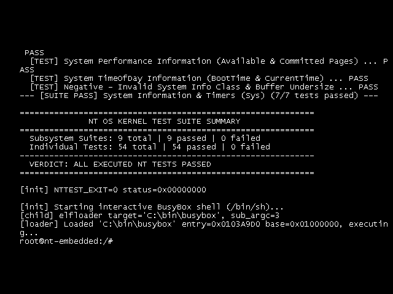

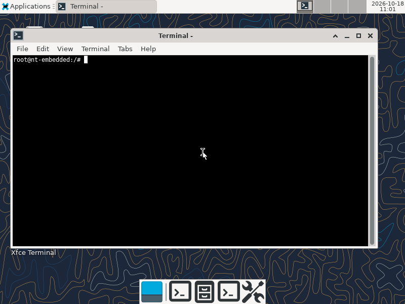

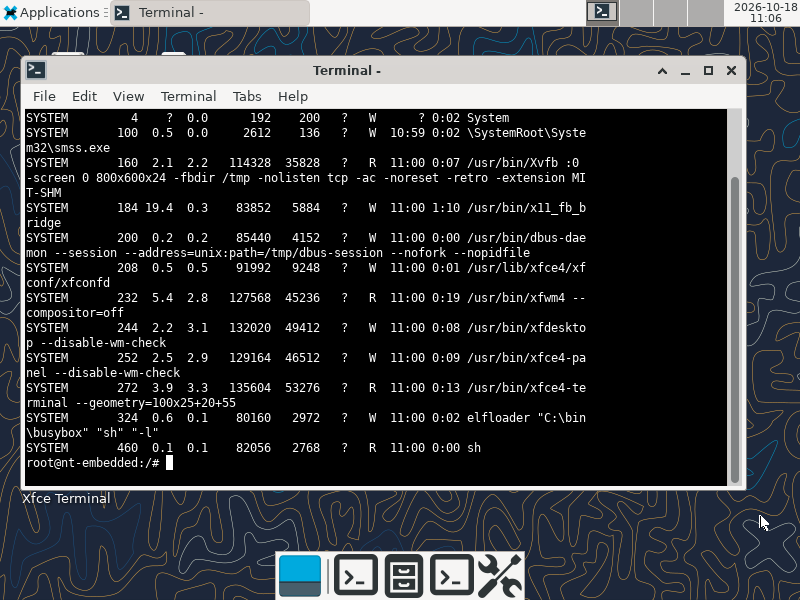

The interactive minimal shell runs BusyBox pipelines and queries the loaded NT modules:

```sh
expr 137 - 29
echo hello | grep h; echo x | head -1; echo rc=$?
grep -c root /etc/passwd; ls /WINDOWS/system32 | grep -i -e ntoskrnl -e hal
ls /WINDOWS/system32/drivers | grep -c sys; busybox --list | wc -l
lsmod -a | grep -i -e ntoskrnl -e hal -e rtl
```

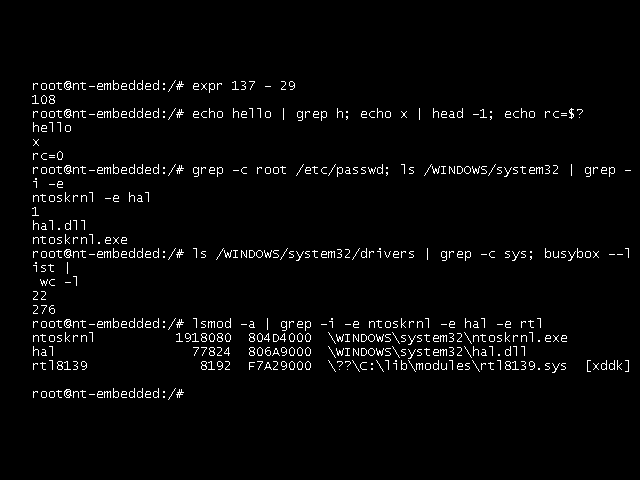

## Commands in the XFCE terminal

These screenshots were captured on 2026-10-18 from the running XFCE terminal in QEMU, using the XFCE image recorded under `xfce_terminal_captures` in [docs/verification.json](docs/verification.json). A mouse click focused the terminal and the commands were typed through the emulated keyboard. The images are unedited framebuffer captures.

### NT kernel, Linux userland

The kernel and its drivers are PE images (`MZ`); BusyBox and XFCE are Linux ELF binaries (`\177ELF`) using musl and GTK. The live module list comes from NT, and no Linux `/proc` exists:

```sh
for f in /WINDOWS/system32/ntoskrnl.exe /WINDOWS/system32/drivers/disk.sys /lib/modules/rtl8139.sys /bin/busybox /usr/bin/xfwm4; do
  printf "%-38s %s\n" $f "$(head -c 4 $f | od -An -c | tr -s " ")"
done
lsmod -a | head -n 3; ls /lib/ld-musl-i386.so.1 /usr/lib/libgtk-3.so.0; ls /proc 2>&1 | head -1
```

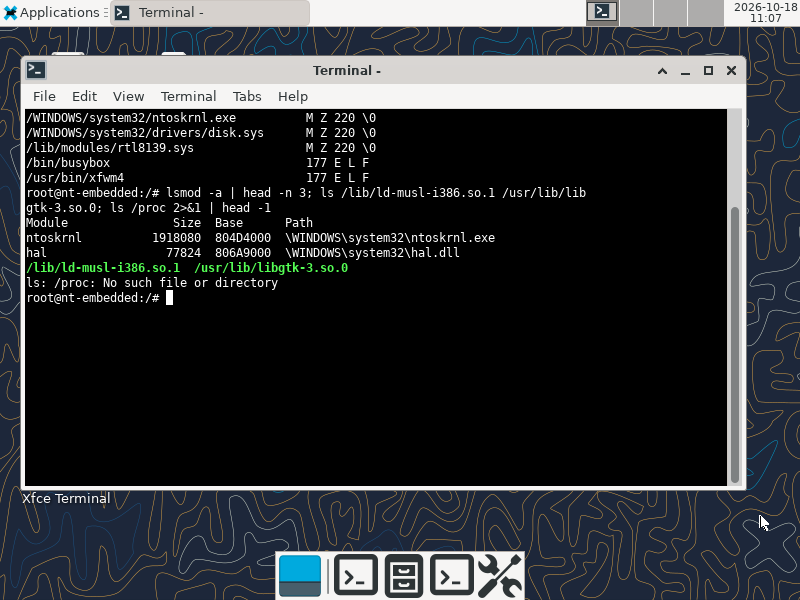

### Loaded embedded drivers: `lsmod`

```sh
lsmod
```

The port's [module-query implementation](rootfs/shim/modtools.c) calls NT's `NtQuerySystemInformation(SystemModuleInformation)`. The default listing shows the four loaded embedded drivers and reports that 18 kernel and boot modules are hidden. `lsmod -a`, shown below, includes them.

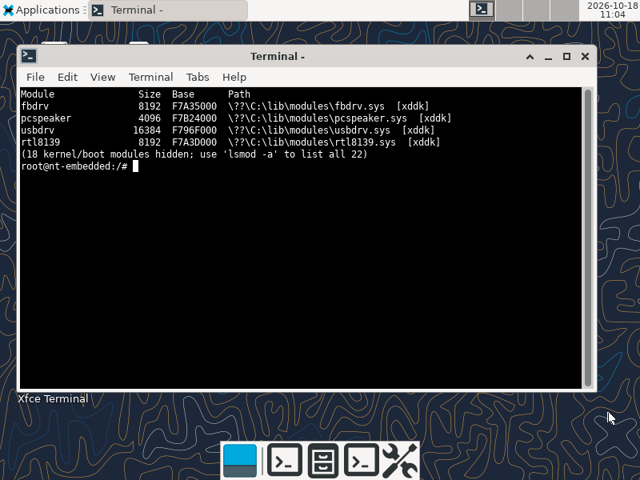

### Compatibility identity: `uname -a`

```sh
uname -a
```

This output is supplied by the [Linux syscall compatibility shim](rootfs/shim/nt_linux_shim.c). Its `Linux`, release and `PREEMPT` fields are hardcoded compatibility strings, so this command does not identify the underlying kernel. The screenshot preserves the actual output. The live NT module query and NT syscall tests provide the kernel evidence.

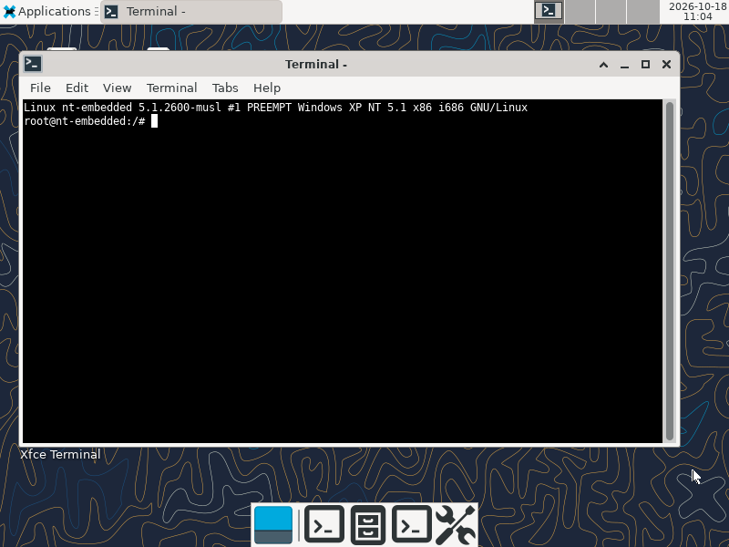

### NT kernel syscall tests: `nttest`

`nttest` with no arguments runs all nine suites. The output is saved and its final 19 lines displayed so the command, exit status and complete summary fit in one capture:

```sh
nttest > /tmp/nttest-capture.txt
echo "nttest exit=$?"
tail -n 19 /tmp/nttest-capture.txt
```

The run completed with exit status 0, nine suites passed and 54/54 executed tests passed.

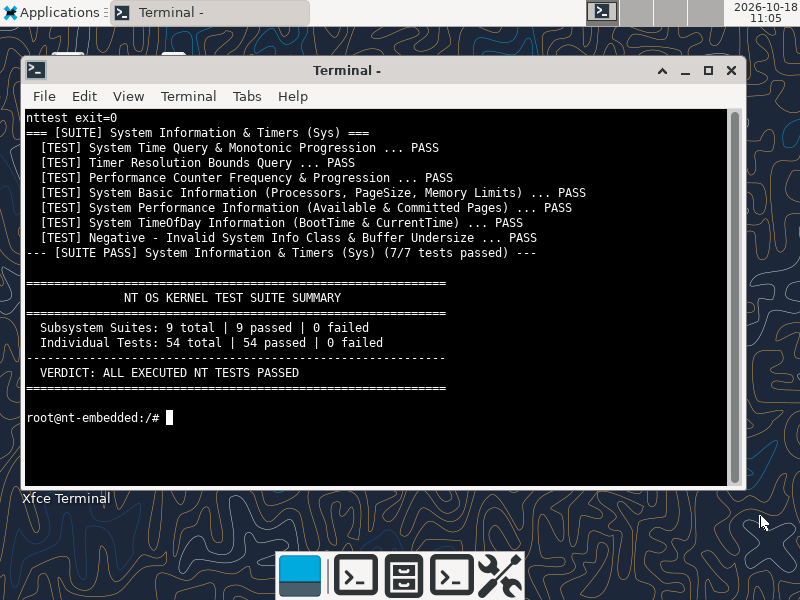

### Kernel and driver files in `WINDOWS/system32`

```sh
cd /WINDOWS/system32
pwd
ls
```

The directory contains `ntoskrnl.exe`, `hal.dll`, `ntdll.dll`, `bootvid.dll`, `kdcom.dll`, the native `smss.exe`, registry configuration and boot drivers.

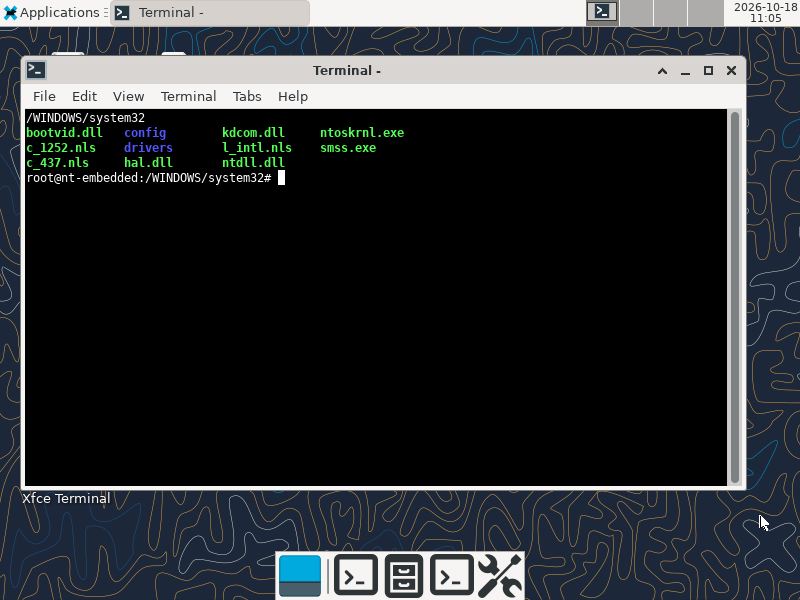

```sh
cd /WINDOWS/system32/drivers
pwd
ls
```

The driver directory includes NT's storage, filesystem, bus and input drivers, alongside the embedded port's drivers.

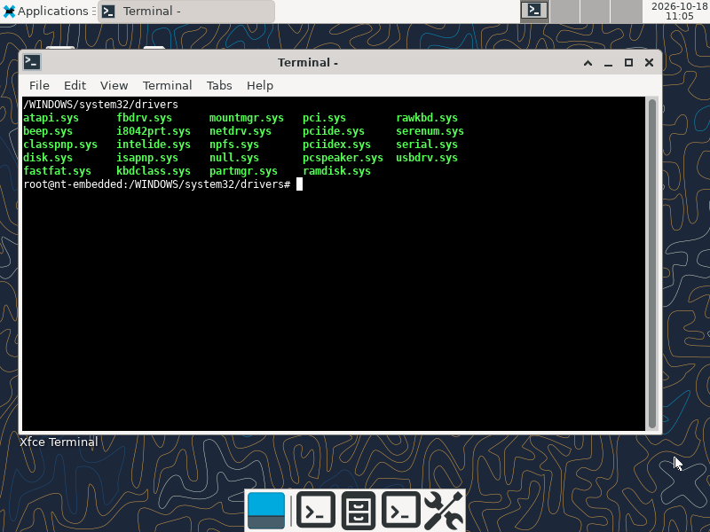

### Further NT kernel evidence

`lsmod -a` queries all loaded NT modules, including the running `ntoskrnl.exe`, `hal.dll`, `KDCOM.DLL`, `BOOTVID.dll` and `.sys` boot drivers, with their actual image sizes and load addresses:

```sh
lsmod -a
```

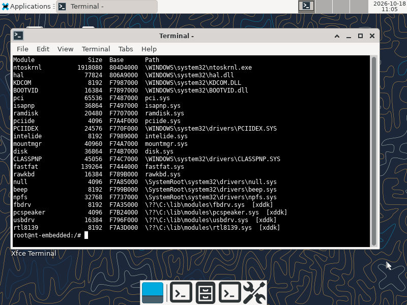

The [registry tests](tests/test_cm.c) exercise NT's Configuration Manager through `NtOpenKey`, `NtCreateKey`, `NtSetValueKey`, `NtQueryValueKey`, enumeration and deletion. This run passed all five tests:

```sh
nttest cm
```

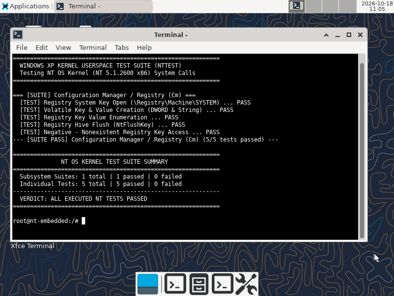

The [security tests](tests/test_se.c) query NT process tokens, user SIDs, groups and privileges, and exercise token duplication and invalid-token handling. All six tests passed:

```sh
nttest se
```

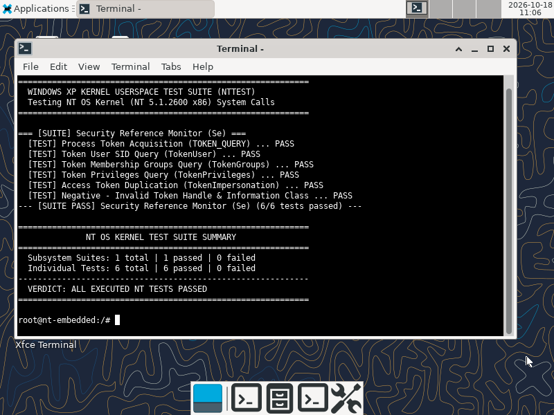

The [process-query backend](native/ntps.c) reads the live NT process snapshot. This excerpt includes NT's idle process, `System` and the native session manager, alongside the XFCE processes:

```sh
ps aux > /tmp/ps-capture.txt
head -n 8 /tmp/ps-capture.txt
```

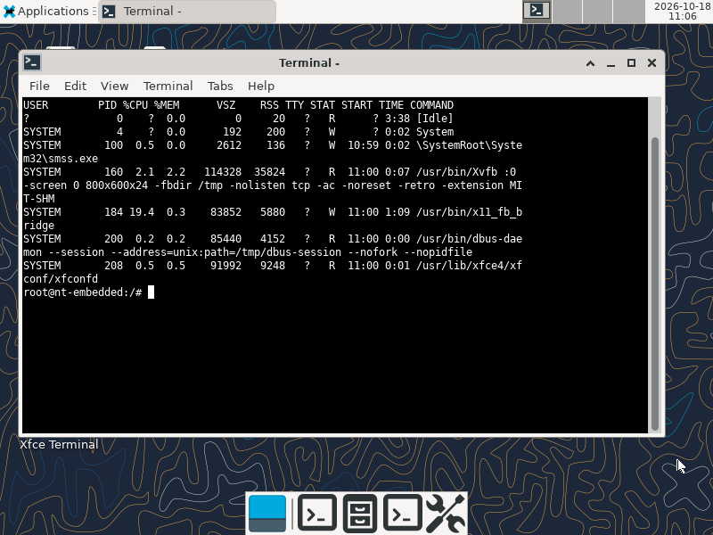

### Chromium 158 (Headless & GUI Variants) on XFCE 4.18

The `chromium` variant ([chromium_rootfs/](chromium_rootfs/README.md)) boots the NT 5.1 kernel, initializes the RTL8139 network driver (`rtl8139.sys`) and user-mode IPv4 TCP/UDP daemon ([netd.c](chromium_rootfs/shim/netd.c)), launches the Alpine XFCE 4.18 desktop environment, and is configured to execute both pre-built 32-bit x86 Chromium 158.0.8107.0 variants (`headless_shell` and `chrome`) directly through the NT-to-Linux syscall shim ([nt_linux_shim.c](chromium_rootfs/shim/nt_linux_shim.c)) with zero Wine:

- **SwiftShader Probe**: Direct EGL/GLESv2 offscreen framebuffer render verifying ANGLE OpenGL ES 3.1 on the SwiftShader Vulkan ICD (`[rc.sysinit] SWIFTSHADER_PROBE_EXIT=0`).
- **Headless Chromium (`headless_shell`)**: Pre-built 32-bit `headless_shell` (`--headless --dump-dom`) verifying Blink HTML parsing, V8 JavaScript execution (`6 * 7 = 42`, `30 + 41 = 71` -> `NT51_JS_RESULT_42_71`), and DOM serialization (`[rc.sysinit] CHROMIUM_HEADLESS_EXIT=0`).
- **GUI Chromium (`chrome`) Targeting `www.yahoo.com`**: Pre-built 32-bit `chrome` browser navigating to `https://www.yahoo.com/` over live DNS and TLS/HTTPS connections via `netd` + `rtl8139.sys`, rendering `www.yahoo.com` inside the XFCE 4.18 desktop (`xfwm4`, `xfce4-panel` top bar and bottom dock, `xfce4-terminal`, and `xfdesktop`) with readiness checked via X11 `WM_NAME` (`Yahoo | Mail, Weather, Search, Politics, News, Finance, Sports & Videos - Chromium`) and X11 `GetImage` viewport pixel inspection.

```sh
python tools/qemu.py chromium --verify --timeout 1800
```

The capture below is from the 2026-10-18 run, which passed every check above and showed that day's yahoo.com page. Its title and pixels do not establish TLS certificate validation. The geolocated city in Yahoo's weather and events cards is masked in these captures; they are otherwise unedited. Mouse-wheel and keyboard captures appear under [Keyboard and mouse input](#keyboard-and-mouse-input).

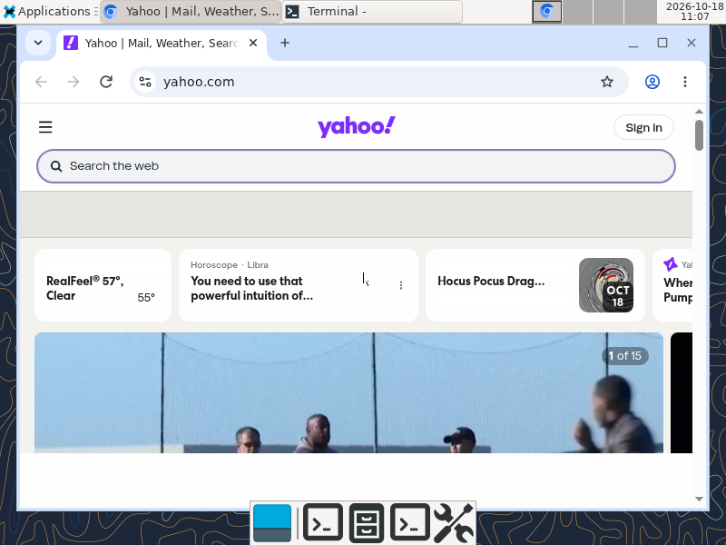

For Chromium source patches (`chromium_nt51_x86.patch`) and developer rebuild instructions for both `chrome` and `headless_shell`, see [chromium_rootfs/patches/README.md](chromium_rootfs/patches/README.md) and [chromium_rootfs/README.md](chromium_rootfs/README.md).

## Scope and limitations

The source drop contains binary-only Executive seed objects and published runtime/support libraries. They remain explicit external inputs; see [THIRD_PARTY.md](THIRD_PARTY.md). The build cannot reconstruct their missing source.

XFCE and its Linux dependencies are pinned Alpine binaries. This project builds the NT kernel and embedded runtime from available source; it does not rebuild Alpine. The syscall port implements a subset of Linux behavior and retains compatibility no-ops for some signals, permissions and scheduling operations. It is not a complete Linux ABI or a production OS. Unknown calls return ENOSYS. The minimal image also rejects unimplemented epoll/eventfd operations instead of returning a fabricated descriptor. The Chromium shim’s `getrandom` fallback is noncryptographic, and its compatibility library suppresses C++ exit callbacks. These behaviors do not provide production Linux cleanup or security semantics.

The Chromium GUI launcher uses CPU rendering with GPU and SwiftShader disabled. SwiftShader is exercised separately by the EGL/GLES probe and requested by the headless launcher. Headless verification requires an explicit zero timeout flag as well as exit status zero. A visible browser window does not establish that SwiftShader rendered it.

The graphics bridge targets QEMU's standard VGA/Bochs framebuffer and PS/2 input, including the IntelliMouse wheel. The CPU-rendered Chromium GUI takes several seconds to repaint after scrolling or typing. Single-process Chromium is bounded by NT's 2 GiB user address space: an earlier long session failed 3.4 MiB reservations with `STATUS_NO_MEMORY`, although the final runs and repeated scrolling had no mapping failures. Booting with `/3GB` faults in NTLDR during the kernel hand-off and is not used. BusyBox applets run in-process after an emulated vfork; the shim resets the state a real exec would, but a vfork child still finishes before its parent resumes. The custom USB driver is experimental; controller enumeration is not proof of complete USB device support. Physical hardware boot is unverified. Networking and TLS are incomplete.

XFCE runs through a session D-Bus daemon, without a complete Linux service environment. System D-Bus, login/power services and some thumbnailing/service activation are unavailable. The default panel omits plugins that require those services. The NT tests cover 54 test cases across nine suites; passing them does not establish complete kernel or Linux compatibility.

Earlier embedded scripts in the minimal/XFCE rootfs simulated compiler/debugger success, SSH authentication/file transfer, and successful HTTP replies after connection failure. Those compiler/SSH implementations and their image aliases are excluded, and their retained dispatch hooks return an unavailable error. In `chromium_rootfs/`, outbound IPv4 UDP/TCP networking is serviced by the RTL8139 kernel driver (`rtl8139.sys`) and user-mode TCP/IP daemon (`netd`), allowing pre-built 32-bit Chromium (`chrome` and `headless_shell`) to resolve DNS and fetch HTTPS pages over the QEMU NIC without synthetic responses.

Guessed USB devices, fallback DNS answers and fabricated successful ping/HTTP results are removed. Network applets now fail when the driver query fails instead of inventing adapter identity and link readiness. `ifconfig [eth0]` only queries the driver’s fixed QEMU IPv4 configuration; changing it is unsupported. `route` displays that user-mode configuration, rather than claiming to query NT kernel routes. Only UHCI transfers are implemented by the custom USB driver; other controller types are reported as unsupported. This does not make the remaining experimental drivers complete.

## Layout and license

* `minimal_rootfs/`: minimal embedded system.
* `rootfs/`: XFCE embedded system and pinned Alpine manifest.
* `chromium_rootfs/`: 32-bit Chromium variant with SwiftShader Vulkan/GLES software rendering, FAT16 raw disk direct-mapping, and X11 integration.
* `native/`: shared native ntdll, libc support and registry hive generator.
* `tests/`: direct NT syscall assertions for nine subsystems.
* `bazel/`, `patches/`, `tools/`: dependency initialization, build actions, packaging and QEMU validation.

Project code is GPL-2.0-only. Upstream component licenses remain applicable; [THIRD_PARTY.md](THIRD_PARTY.md) describes the boundaries. Build outputs, runtime logs and downloaded external source are ignored by Git.

The [license header review](docs/license-audit.md) documents the coverage and preserved upstream files. `REUSE.toml` supplies license metadata for project files whose formats cannot accept comments.

Repository release checks:

```sh
python3 tools/audit_privacy.py --json
python3 -m unittest discover -s tests -p 'test_*.py'
reuse lint
```

The privacy audit checks publishable text and binary files for personal
identifiers, private paths, machine identifiers and common credential formats.
It reports repository-relative filenames and categories without printing
matched values. Required upstream notices and functional vendor strings remain.
License metadata and component notices are described in [THIRD_PARTY.md](THIRD_PARTY.md).
